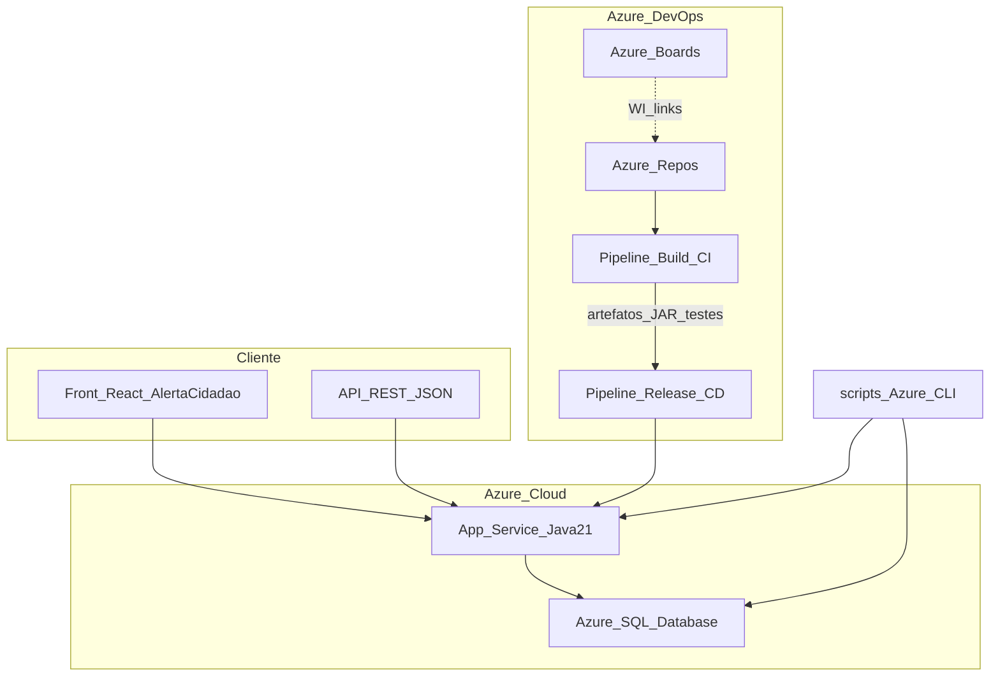

# Arquitetura Macro — AlertaCidadao (CitizenTech / DevOps GS)

## CitizenTech (resumo)
- **Cidadão:** morador do bairro  
- **Problema:** alagamento / risco hídrico sem canal de alerta  
- **Solução:** API de alertas + atualizações de status  
- **ODS 11** · **ODS 13**

## Diagrama

## Componentes
| Camada | Tecnologia |
|--------|------------|
| Front | React + Vite (servido no mesmo App Service) |
| App | Spring Boot 3.3 / Java 21 / JWT |
| Persistência | JPA + Flyway + Azure SQL (`ac_*`) |
| CI/CD | Azure Pipelines (`azure-pipeline.yml`) |
| IaC | `scripts/provision-azure.ps1` |

